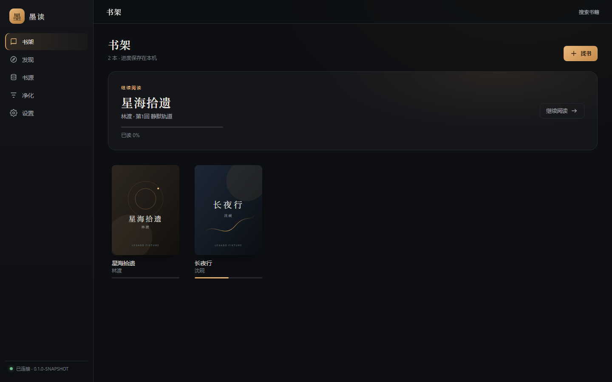
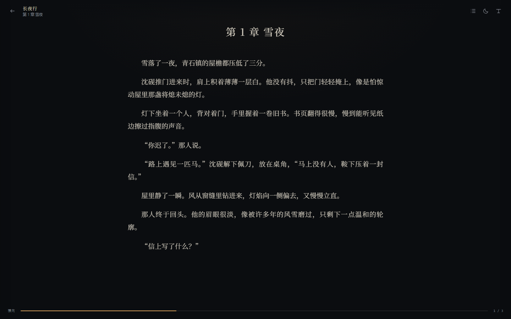
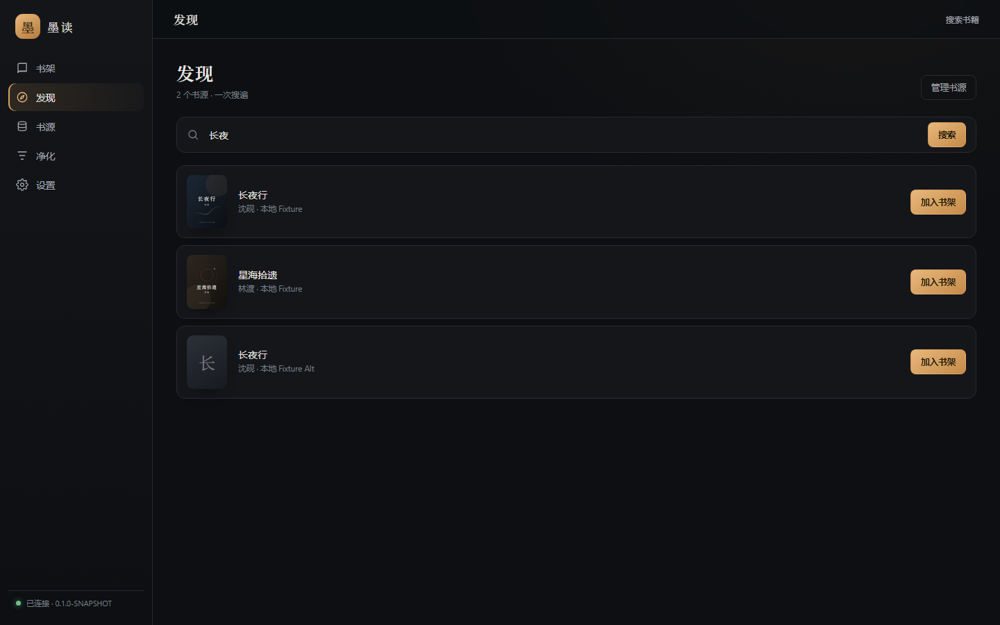
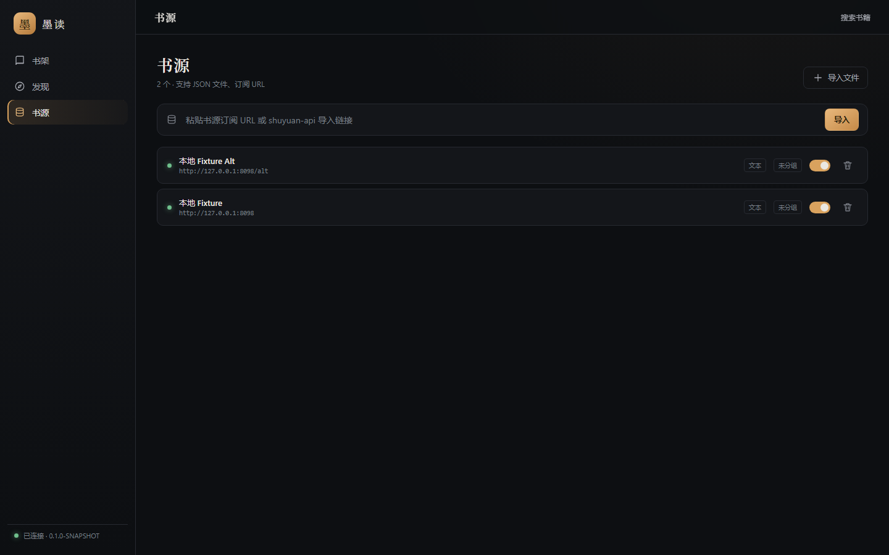
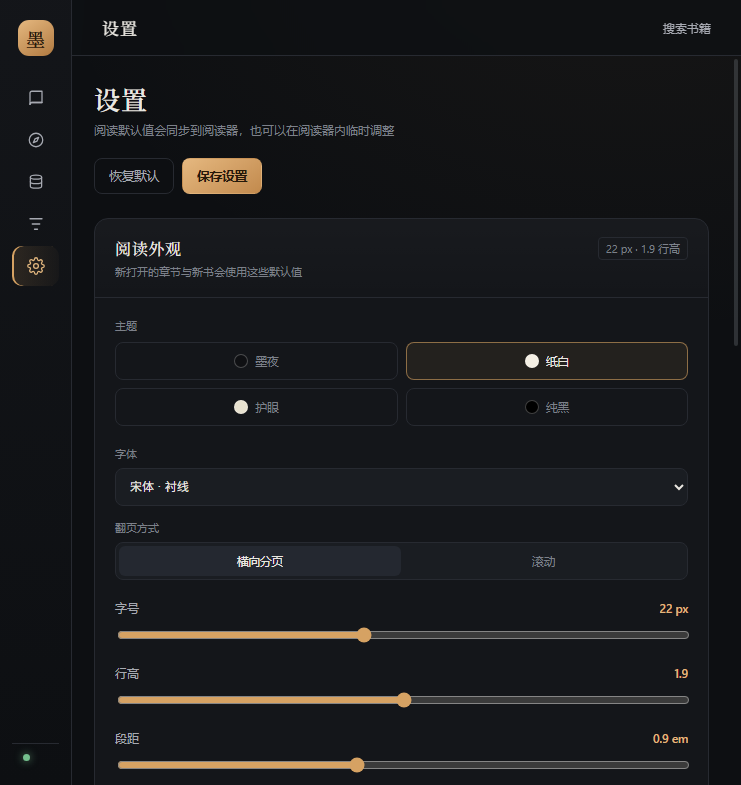
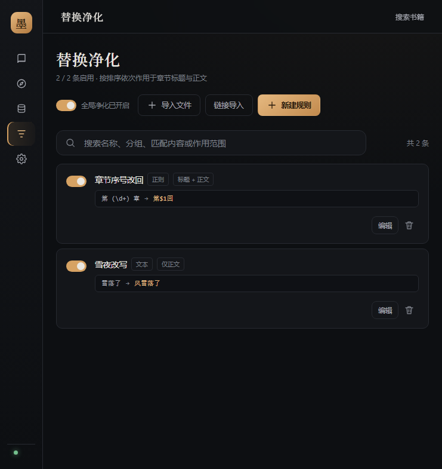

# 墨读 · Legado Desktop

[](https://www.microsoft.com/windows)
[](https://kotlinlang.org/)
[](https://vuejs.org/)
[](https://tauri.app/)
[](LICENSE)
[](../../releases)

> 一个本地优先的 Windows 桌面阅读器：兼容 Legado 书源，支持小说、漫画、视频与透明浮窗阅读。

墨读（Legado Desktop）是 [Legado（阅读 3.0）](https://github.com/gedoor/legado) 的 Windows 桌面移植版。项目使用 Kotlin/JVM 复用 Legado 的书源解析引擎，用 Vue 3 实现界面，由 Tauri v2 负责桌面窗口、托盘、WebView2 与本地服务生命周期。

应用采用**纯单机**设计：Tauri 启动时在回环地址拉起本地 JVM 服务并随机分配端口与 token，书架、书源、阅读进度、缓存和设置全部保存在本机 SQLite 与数据目录中，不需要部署服务端、数据库容器或注册账号。安装包自带精简 JRE，用户无需额外安装 Java。

> [!IMPORTANT]
> 本项目不内置书源，也不提供任何书籍内容。首次启动后请导入自己拥有合法使用权的 Legado JSON 书源。当前仅支持 **Windows 10/11 x64**，不支持 macOS / Linux。

## 界面预览

<p align="center"></p>
<p align="center"></p>

<p align="center">
  
  
</p>

<p align="center">
  
  
</p>

*截图为开发阶段版本，实际界面以最新安装包为准。*

## 项目亮点

- **本地优先**：无账号、无云端服务，数据保存在自己的设备中；安装版自带 JRE。
- **兼容 Legado 生态**：支持 Legado JSON 书源、常见 CSS / JSONPath / XPath / 正则 / JavaScript 规则。
- **多类型阅读**：小说横向分页与滚动、漫画纵向阅读、视频 HLS 播放，统一在一个桌面应用里。
- **透明浮窗**：无边框小窗，可拖动、八方向缩放、置顶、全局老板键，并与主阅读器双向同步进度。
- **CF 兜底**：OkHttp 直连失败后自动回退 WebView2；隐藏挑战失败时弹出可见验证窗口，也支持手动「网页验证」。
- **可定制阅读**：阅读主题、字体、字号、行高、段距、页宽、简繁转换与替换净化均可调整。
- **Windows 桌面体验**：托盘、单实例、关闭到托盘、浮窗、原生标题栏主题同步与 NSIS 安装包。

## 功能一览

### 书源、搜索与发现

- 导入 JSON 书源文件，或粘贴书源订阅 URL导入链接
- 书源启用、停用、删除、分组，以及书源详情查看与规则测试
- 书源可视化编辑，兼容 CSS、JSONPath、XPath、正则与 Rhino JavaScript 规则
- 书源登录窗口、Cookie 保存与清理
- 多书源并行搜索，通过 SSE 实时展示每个书源的进度与结果
- 发现页支持 `exploreUrl`（含 `@js:` 规则）和书源 tag 流式选择
- 搜索结果可直接查看详情、试看或加入书架，不必先加入书架
- 按网址加入书架：按书源 `origin`、`bookSourceUrl` 前缀与 `bookUrlPattern` 自动匹配书源，并迁移同名同作者书籍的阅读进度
- 书籍详情、目录刷新、换源与章节缓存

### 书架与阅读

- 书架支持封面墙、列表、横屏布局，封面比例可选 4:3 / 16:9
- 作品简介最多两行展示，支持按全部 / 小说 / 漫画 / 视频筛选
- 横向分页与滚动两种阅读模式，窗口缩放后自动重排
- 墨夜、纸白、护眼、纯黑四套阅读主题，以及 5 套应用整体主题
- 字体、字号、行高、段距、页宽可调，阅读排版实时生效
- 目录、书签、章内搜索三个侧栏；目录可手动刷新并缓存到本地
- 顶部工具条可一键强制刷新当前章节正文（跳过缓存重新抓取，失败时保留旧正文）
- 正文图片经本地代理加载，带书源请求头、Referer、Cookie 与解密规则
- 正文 / 标题替换净化：文本与正则规则、书名 / 书源作用域、在线测试
- 正文简繁转换：不转换（默认）/ 统一简体 / 统一繁体，只影响显示，不修改原始缓存
- 章节正文缓存与离线回退；封面、正文图片本地缓存与清理
- 阅读进度自动保存；主窗口与浮窗通过章内千分比同步，不依赖相同分页宽度

### 视频与漫画

- 视频源详情页：左上播放器、下方选集、右上作品信息与封面
- `<video>` + hls.js 播放，支持 AES-128 加密 HLS、清晰度切换、倍速、原生全屏与画中画
- 播放进度按毫秒恢复，自动下一集；检测到 Widevine / PlayReady 等 DRM 时明确提示不支持
- 本地 `/media` 代理支持 Range / 206、流式传输与 m3u8 重写（子列表、分片、`EXT-X-KEY`、`EXT-X-MAP`）
- WebView2 资源嗅探兜底：监听 fetch / XHR / 资源时序 / `<video>`，命中 m3u8 / mp4 / flv 等地址
- 漫画阅读器：纵向滚动、适应宽度、当前章内存缓存（切章或退出即释放）、页码进度与书签

### 浮窗阅读

- 独立无边框透明窗口，默认置顶（可在设置关闭），不占任务栏、不进入 Alt+Tab
- 按住正文可拖动，四边 / 四角可缩放，最小 300×200；位置与大小自动记忆
- 全透明、半透明黑底白字、半透明白底黑字与自定义背景；透明度 0–100%
- 文字描边 / 阴影、可选随窗口宽度自适应的字号、顶部 / 底部 / 隐藏进度
- 鼠标滚轮、方向键、PgUp / PgDn、空格与左右点击区域翻页，翻页无动画
- 右键菜单：返回主窗口、打开设置、切换置顶、隐藏
- 默认老板键 `Ctrl+Alt+X`，可在设置中录入组合键并实时重新注册；支持紧急隐藏主窗口
- 与主阅读器双向同步章节与进度；关闭浮窗 / 关闭应用前保存进度

### 桌面与数据

- 托盘双击显示主窗口，右键菜单包含浮窗显隐
- 主窗口老板键 `Ctrl+Alt+H`、单实例、关闭到托盘
- 5 套应用主题（墨夜、青灰、纯黑、纸白、护眼），Windows 原生标题栏跟随深浅色
- 书架、书源、书签、替换规则、设置与章节缓存统一存入 SQLite
- 缓存统计与一键清理；设置页展示数据目录、数据库大小与内容数量
- 安装包自带 jlink 精简运行时；NSIS 安装 / 卸载

## 快速开始

1. 前往 [Releases](../../releases) 下载 Windows x64 安装包。
2. 启动应用，在「书源」页导入自己拥有合法使用权的 Legado JSON 书源。
3. 在「搜索」或「发现」中找到书籍，查看详情、试看或加入书架。
4. 打开书籍开始阅读；右上角可进入浮窗模式，也可以按 `Ctrl+Alt+X` 随时隐藏 / 显示浮窗。
5. 在「设置」中调整应用主题、阅读排版、简繁转换、浮窗样式与老板键。

> [!NOTE]
> 安装包未配置代码签名，Windows SmartScreen 可能提示“未知发布者”；确认来源可信后再继续运行。

## 下载与平台

| 系统 | 架构 | 安装包 | 说明 |
| --- | --- | --- | --- |
| Windows 10 / 11 | x64 | NSIS | 自带 jlink 运行时，无需单独安装 Java |

当前只提供 Windows x64 构建。安装包约 54 MB；应用暂时没有自动更新、便携 ZIP 或 macOS / Linux 版本。

安装版数据默认保存在：

```text
%APPDATA%\io.xiatou.legado.desktop\
  legado.db          书架、书源、书签、替换规则、设置、章节缓存
  cache\covers\      封面与正文图片缓存
  logs\server.log    本地服务日志
  float-window.json  浮窗位置、大小、置顶与老板键配置
```

备份时关闭程序后复制整个目录即可；卸载程序默认不会删除该数据目录，确认不再需要后可手动清理。

## 开发与构建

### 环境要求

| 依赖 | 版本 | 说明 |
| --- | --- | --- |
| JDK | 17 | 需要 `JAVA_HOME`；打包时使用其中的 `jlink.exe` |
| Node.js | 20+ | 构建前端、运行 Tauri CLI |
| Rust | 1.90+ | Tauri 2.12 依赖 edition2024，旧工具链会报错 |
| Visual Studio Build Tools | 2022 | 安装“使用 C++ 的桌面开发”，提供 MSVC 链接器 |
| WebView2 | Evergreen | Windows 10/11 通常已内置 |
| PowerShell | 5.1+ | 执行项目脚本 |
| Gradle | 8.13 | 仓库自带 wrapper，无需单独安装 |

### 首次构建

```powershell
.\gradlew.bat :core:test :server:test
.\gradlew.bat :server:installDist

cd frontend
npm install
npm run build
cd ..
```

### 浏览器模式（前端热更新）

```powershell
# 终端 1：本地 JVM 服务
.\gradlew.bat :server:run --args="--port 1122 --dev-no-auth"

# 终端 2：Vite
cd frontend
npm run dev
```

打开 <http://127.0.0.1:5173>。Vite 已将 `/api`、`/healthz`、`/img`、`/media` 代理到 `127.0.0.1:1122`。`--dev-no-auth` 仅用于本机开发，不要暴露到局域网。

浏览器模式方便调界面，但没有浮窗、托盘、原生标题栏、CF WebView 与 WebView2 嗅探等桌面能力。

### 桌面模式（Tauri dev）

首次运行前先完成 `:server:installDist` 与 `npm run build`，然后：

```powershell
powershell -ExecutionPolicy Bypass -File scripts/dev-tauri.ps1
```

脚本会加载 MSVC 环境、固定 Rust 1.90.0、按需安装 `desktop/node_modules`，再启动 Tauri 窗口。debug 壳直接读取仓库中的 `server/build/install/server` 与 `frontend/dist`，**不接 Vite 热更新**；改前端后需要重新 `npm run build`，改 Kotlin 后需要重新 `:server:installDist`。

### 打包 NSIS

```powershell
powershell -ExecutionPolicy Bypass -File scripts/package-tauri.ps1
```

脚本依次构建前端、服务端、jlink 运行时，并调用 Tauri CLI 生成安装包：

```text
desktop/src-tauri/target/release/bundle/nsis/
```

GitHub 下载 NSIS 超时时可加镜像：

```powershell
powershell -ExecutionPolicy Bypass -File scripts/package-tauri.ps1 `
  -GithubMirror "https://ghfast.top/https://github.com"
```

### 测试

```powershell
.\gradlew.bat :core:test :server:test
.\gradlew.bat build
cd frontend
npm run build
```

`npm run build` 同时执行 `vue-tsc --noEmit`，用于前端类型检查。

更多细节见 [`docs/build-and-usage.md`](docs/build-and-usage.md)、[`docs/server-api.md`](docs/server-api.md) 与 [`PLAN.md`](PLAN.md)。

## 技术架构

```text
Tauri v2 (Rust)
  ├─ 启动 jlink javaw.exe：server/lib/*，随机端口 + 一次性 token
  ├─ 轮询 /healthz → 打开 /bootstrap?token=...
  ├─ 桌面能力：托盘、单实例、老板键、浮窗、原生标题栏主题
  ├─ WebView2 桥：CF 验证、Cookie 回传、资源嗅探、浮窗控制
  └─ Job Object：退出 / 崩溃时回收整个 JVM 进程组

JVM 本地服务（NanoHTTPD）
  ├─ 书源规则、搜索、目录、正文、图片解密
  ├─ SQLite、章节缓存、媒体代理 /media、SSE 搜索
  └─ 静态资源 frontend/dist
```

| 层 | 选型 |
| --- | --- |
| 规则引擎 | Kotlin/JVM、Rhino、jsoup、Jayway JsonPath、OkHttp |
| 本地服务 | NanoHTTPD 2.3.1、SQLite、SSE、Range 流式代理 |
| 前端 | Vue 3、TypeScript、Vite、Pinia、Vue Router、hls.js |
| 桌面壳 | Rust、Tauri v2、WebView2、tiny_http 本地桥 |
| 打包 | Gradle、jlink、Tauri NSIS |

主要目录：

| 目录 | 说明 |
| --- | --- |
| `core/` | 纯 JVM 引擎：书源规则、搜索、目录、正文、Rhino JS |
| `rhino/` | Rhino 的 JVM 封装 |
| `cli/` | 引擎命令行：search / info / chapters / content |
| `server/` | NanoHTTPD API、SQLite、鉴权、静态资源、图片与媒体缓存 |
| `frontend/` | Vue 3 + Vite 桌面界面 |
| `desktop/` | Tauri v2 壳：JVM 托管、托盘、浮窗、WebView2 桥与打包配置 |
| `design/` | 设计规范、原型与界面截图 |
| `docs/` | 构建、API、前端、上游同步与兼容性文档 |
| `examples/` | 本地 fixture 站点与示例书源 |
| `scripts/` | 开发、打包与环境脚本 |

## 书源兼容

书源使用 Legado 的 JSON 格式，常用字段包括 `bookSourceUrl`、`bookSourceName`、`searchUrl`、`exploreUrl`，以及 `ruleSearch`、`ruleBookInfo`、`ruleToc`、`ruleContent` 等规则组。

规则支持 `@css:`、`@json:`、`@xpath:`、`@regex:` 与 JavaScript。JavaScript 由本地 Rhino 引擎执行；导入不可信书源前仍应检查其中的请求地址与脚本内容。

部分站点启用了 Cloudflare 或其他人机验证：

- 直连 OkHttp 超时为 30 秒，403 / 412 / 503 或超时后自动回退 WebView2；
- 隐藏窗口自动挑战失败时，会弹出置顶的「完成安全验证」窗口；
- 阅读页加载失败时可直接点击「网页验证」，完成验证后关闭窗口，后续章节复用 WebView 会话。

本项目为独立的非官方 Windows 移植，上游 Android 工程只作为行为规范保持只读，不随本仓库修改。上游来源与同步策略见 [`docs/upstream.md`](docs/upstream.md)。

## 数据与隐私

- 应用没有集中式账号系统，不收集遥测；书架、设置、缓存与阅读记录默认保存在本机。
- 搜索、目录、正文、图片和视频请求会访问用户自己配置的书源站点；Cookie 与 WebView2 会话保存在本机。
- 书源登录 Cookie 按书源保存在本地数据库，重启后仍可使用。
- 本项目不提供、维护或推荐任何第三方书源，用户应自行判断来源的安全性与合法性。
- 备份与迁移可通过复制 `%APPDATA%\io.xiatou.legado.desktop` 完成。

## 已知限制

- 仅支持 Windows 10/11 x64，暂无 macOS / Linux 构建。
- 不内置任何书源或书籍内容。
- 视频不支持 Widevine / PlayReady 等 DRM；检测到 DRM 时只能提示不可播放。
- 暂不支持听书 / TTS、RSS、本地 TXT / EPUB / PDF、WebDAV 同步与整本离线下载。
- 章节缓存与封面缓存可离线回退，但不是完整的整本下载功能。
- CF / 人机验证无法保证对所有站点自动通过；必要时需要手动完成一次验证。
- 部分复杂书源规则可能无法完全兼容，欢迎附上书源 JSON（请先脱敏 Cookie / token）反馈。
- 安装包未配置代码签名，SmartScreen 可能提示未知发布者。

## 其他

> [!WARNING]
> 本项目不内置、不提供也不推荐任何书源或书籍内容。书源的使用请遵守当地法律法规及来源网站的服务条款；因使用第三方书源产生的任何问题由使用者自行承担。

- **免责声明**：使用本项目前请阅读 [Legado 免责声明](https://gedoor.github.io/Disclaimer)。本项目是独立的非官方 Windows 移植，与 Legado 官方无隶属关系，不对第三方书源、内容或服务的合法性、准确性、可用性作任何保证。
- **阅读 3.0**：本项目基于 [Legado（阅读 3.0）](https://github.com/gedoor/legado) 的书源生态与部分代码实现，遵循 GPLv3；上游版权归原作者所有。
- **书源规则**：书源编写、调试与规则语法可参考 [The tutorial of Legado](https://mgz0227.github.io/The-tutorial-of-Legado/)。该文档为社区资料；本项目对常见 CSS / JSONPath / XPath / 正则 / JavaScript 规则做兼容实现，复杂规则可能仍需按上游行为调整。

## 参与项目

- 遇到问题时，请在 [Issues](../../issues) 中说明系统版本、应用版本、复现步骤、错误提示，并附上 `%APPDATA%\io.xiatou.legado.desktop\logs\server.log` 中的相关日志。
- 提交书源兼容性问题时，请附上最小可复现的书源 JSON，并删除其中的 Cookie、token、账号等敏感信息。
- 欢迎提交 Pull Request；涉及书源解析行为的改动，请尽量补充 fixture 或测试。

## 许可

本项目以 **GPLv3** 发布，详见 [LICENSE](LICENSE) 与 [NOTICE](NOTICE)。

代码源自 [Legado（阅读 3.0）](https://github.com/gedoor/legado)，上游快照与同步说明见 [`docs/upstream.md`](docs/upstream.md)。本项目与 Legado 官方无隶属关系。
