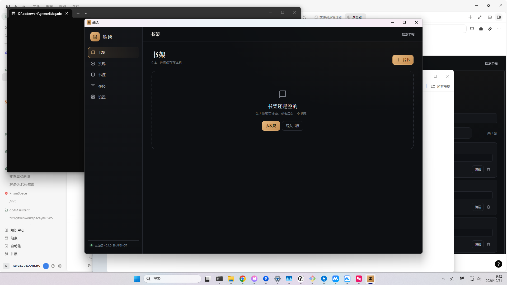

# Tauri 壳（Phase 5）

Tauri v2 桌面壳，负责启动 JVM 服务、等待健康检查、打开本地阅读界面，并在退出时回收 JVM。

## 目录

| 路径 | 说明 |
| --- | --- |
| `src-tauri/` | Rust 工程、Tauri 配置、能力声明、图标 |
| `src-tauri/runtime/` | 打包时生成的 jlink 运行时（`bin/javaw.exe`） |
| `src-tauri/server/` | 打包时复制的服务端发行版（`lib/*.jar`） |
| `src-tauri/frontend/` | 打包时复制的前端静态资源 |

`runtime/`、`server/`、`frontend/` 由 `scripts/package-tauri.ps1` 生成，不提交到版本库；
开发模式会自动回退到仓库里的 `server/build/install/server` 和 `frontend/dist`。

## 运行

准备后端与前端：

```bash
./gradlew :server:installDist
cd frontend && npm run build && cd ..
```

推荐用脚本启动（自动导入 MSVC 环境、固定 Rust 1.90、缺依赖时执行 npm install）：

```powershell
powershell -ExecutionPolicy Bypass -File scripts/dev-tauri.ps1
```

手动启动时需要先设置项目工具链并在 VS 开发者命令行中执行：

```powershell
cd desktop/src-tauri
rustup override set 1.90.0
cd ..
npm run tauri dev
```

如果直接 `npm run tauri dev`，默认 rustup 1.77.0 会报
“feature `edition2024` is required”（time-core 等依赖需要 Cargo 1.85+，
当前 Tauri 2.12 要求 Rust 1.90）。

**环境**：需要 Rust 1.90+、Tauri CLI 与 Visual Studio C++ Build Tools
（Desktop development with C++）。本机已安装 Rust 1.90.0 与 MSVC，
但默认 rustup 工具链是 1.77.0；使用脚本或 `cargo +1.90.0` 构建。
`rustup update stable` 下载较慢时可用 rsproxy 镜像安装 1.90.0。

## 打包

```powershell
powershell -ExecutionPolicy Bypass -File scripts/package-tauri.ps1
# 只准备 jlink/资源，不执行 Tauri 构建：
powershell -ExecutionPolicy Bypass -File scripts/package-tauri.ps1 -NoBuild
# GitHub 下载 NSIS 超时时使用镜像：
powershell -ExecutionPolicy Bypass -File scripts/package-tauri.ps1 `
  -GithubMirror "https://ghfast.top/https://github.com"
```

本机已实际产出：
`desktop/src-tauri/target/release/bundle/nsis/Legado Desktop_0.1.0_x64-setup.exe`（约 50 MB）。
release 可执行文件与调试壳均已验证能启动 JVM、显示窗口，并在关闭时回收 JVM。



脚本会：

1. 构建前端；
2. 执行 `:server:installDist`；
3. 用 `jlink` 生成精简运行时；
4. 复制 `server/lib` 与 `frontend/dist` 到 `src-tauri/`；
5. 调用 Tauri CLI 生成 NSIS 安装包与可执行文件。

输出在 `desktop/src-tauri/target/release/bundle/nsis/`。

## 启动流程

```
Tauri 进程
  ├─ 在 app_data_dir 创建数据目录
  ├─ 选择空闲端口 + 随机 token
  ├─ spawn javaw.exe -cp server/lib/* io.legado.desktop.server.MainKt
  ├─ 将 JVM 加入 Windows Job Object（KILL_ON_JOB_CLOSE）
  ├─ 轮询 /healthz
  ├─ 创建窗口 → /bootstrap?token=...
  └─ 退出时 kill 子进程并关闭 Job Object
```

单实例由 `tauri-plugin-single-instance` 提供；第二次启动会聚焦已有窗口。
托盘、全局快捷键、文件关联、自动更新尚未接。
