# 前端 MVP（Phase 3 切片）

## 页面

| 路由 | 页面 | 功能 |
| --- | --- | --- |
| `/` | 书架 | 书架列表、继续阅读、进度、空状态；支持 `?detail=<bookUrl>` 打开详情、`&switch=1` 打开换源 |
| `/search` | 发现 | 关键词搜索、结果列表、加入书架；支持 `?q=` 深链 |
| `/sources` | 书源 | 列表、订阅 URL 导入、JSON 文件导入、启停、删除 |
| `/replace` | 替换净化 | 规则列表、搜索、启停、新建/编辑、测试、删除、JSON 文件/链接导入 |
| `/settings` | 设置 | 阅读默认值、全局净化开关、数据统计与服务信息 |
| `/read?bookUrl=` | 阅读器 | 横向分页 / 滚动、四主题、排版抽屉、目录抽屉、进度保存 |

阅读器使用 query 参数而不是路径参数，避免 Windows 静态回退把 `http:` 当作非法路径。

### 阅读器

- **全屏沉浸**：进入阅读路由时隐藏 AppShell；顶栏/底栏 2.6s 无操作自动隐藏。
- **两种模式**：横向分页（DOM 度量切页）与滚动；`←/→/Space` 翻页。
- **正文图片**：服务端返回文本/图片块，分页模式按书源 `imageStyle` 预留高度，滚动模式按原图比例展示；图片经 `/img?kind=content` 代理。
- **排版抽屉**：主题（墨夜/纸白/护眼/纯黑）、字体（宋体/楷体/黑体）、字号 16–30、行高、段距、页宽、翻页模式、恢复默认；设置存 `localStorage`。首次访问且本地无设置时，从 `/api/settings` 读取设置页保存的默认值。
- **阅读导航**：左侧抽屉包含目录、书签、搜索三个页签。
  - 书签：保存当前章节 + 页码/滚动位置 + 摘要，可跳转或删除。
  - 搜索：仅搜索当前章节，结果按页/位置分组，点击跳到对应分页或滚动位置。
- **目录抽屉**：章节列表、当前章高亮。
- **分页**：按段落/图片块切分；单段过长时二分查找可容纳的前缀，优先在标点处断开；视口只显示一页，页间 64px。
- **进度**：切章保存 `durChapterIndex`；底栏显示页码与页进度。
- **调试参数**：`panel=settings|toc|bookmarks|search`、`q=关键词`、`theme=ink|paper|eye|black`、`mode=paged|scroll`、`fontSize=16..30`、`page=N`。

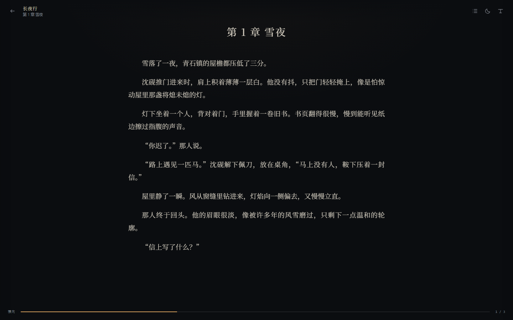
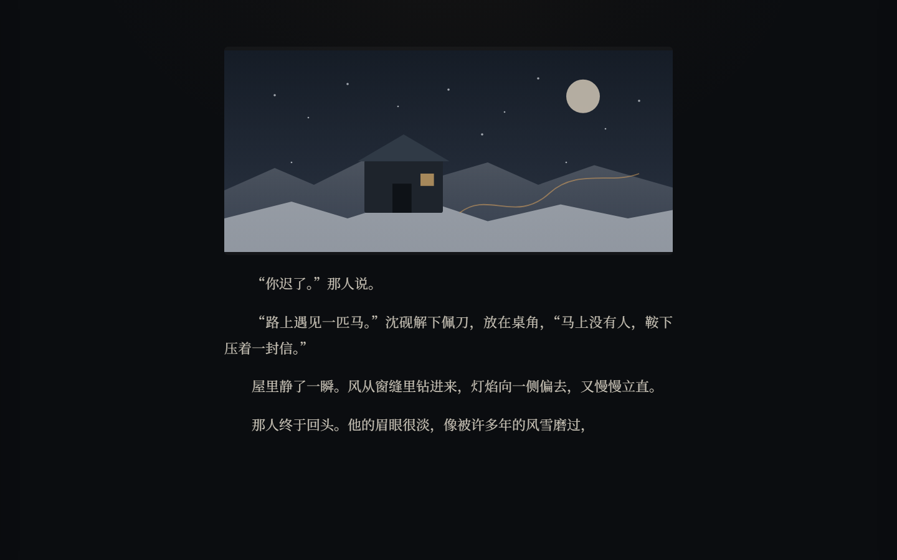

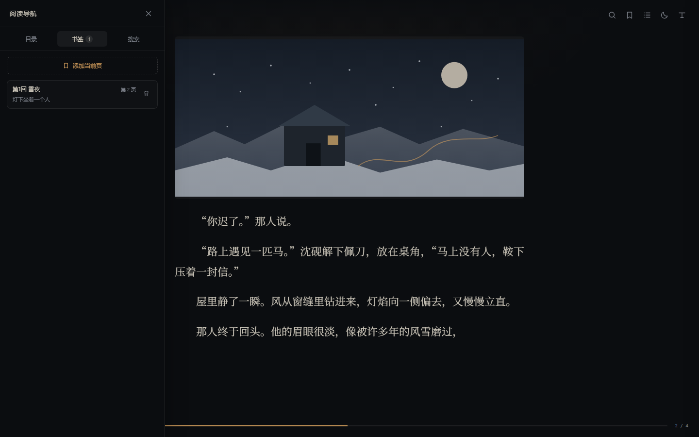
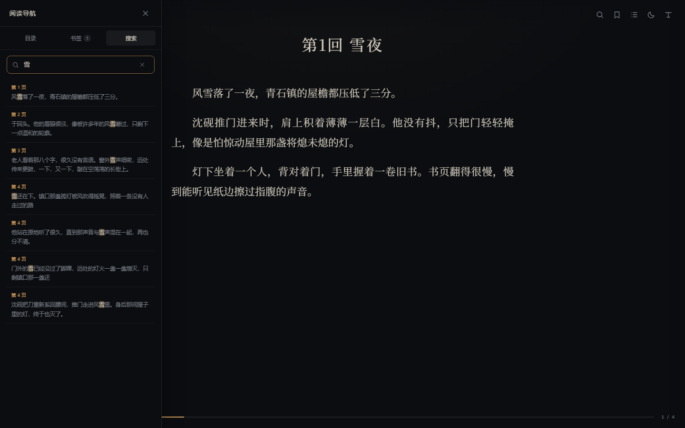
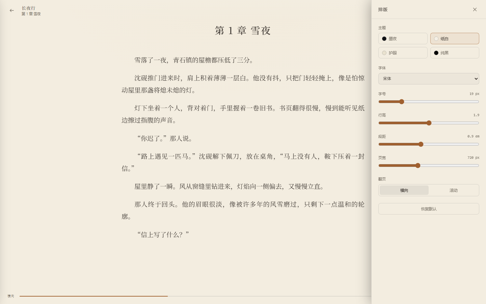

### 详情与换源

- 书架卡片右上角“⋯”打开右侧详情抽屉：封面、作者/来源、分类、章节数、进度、简介、最近 12 章。
- 操作：继续阅读、换源、移出书架；点击章节直接跳到该章（`/read?bookUrl=&index=`）。
- 换源：按书名搜索全部启用书源，过滤当前书 URL；选择候选后后端迁移书籍与章节、保留 `durChapterIndex`，删除旧记录。
- 同域多书源时优先使用候选的 `origin` 作为 `sourceKey`，避免前缀匹配选错源。
- 书源页支持启停开关，停用源不参与搜索。


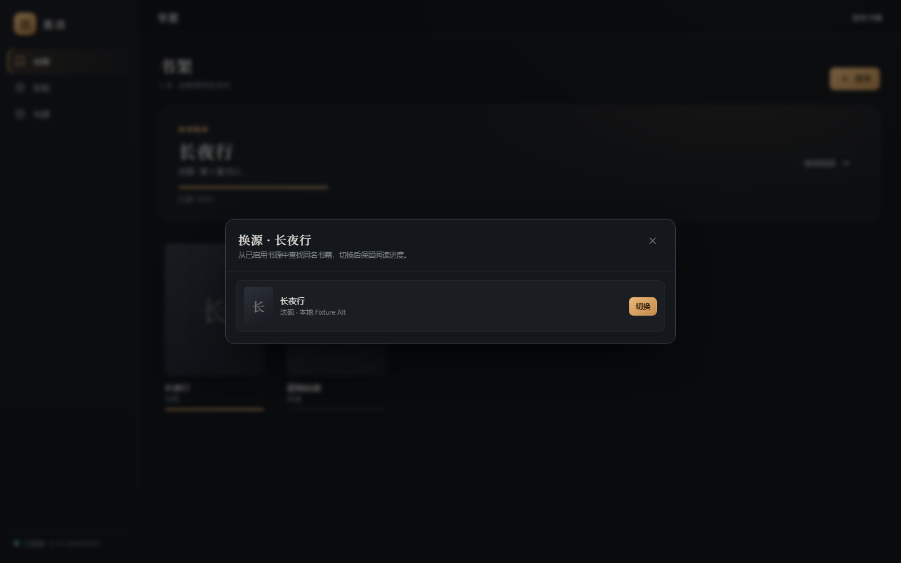
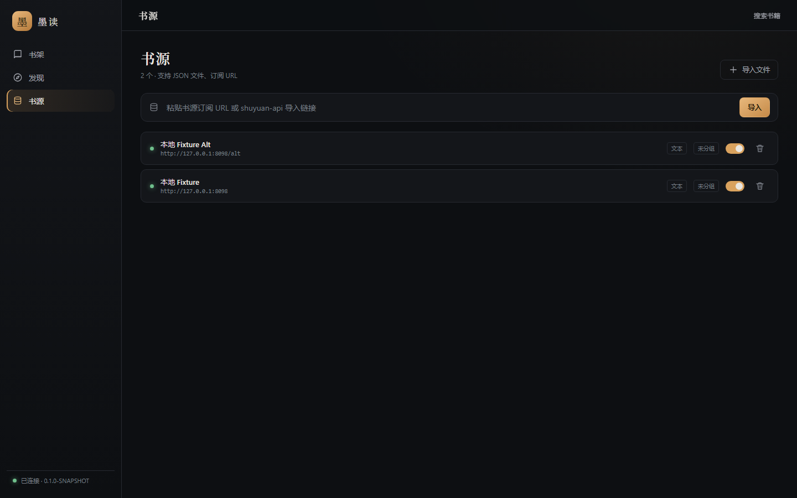

### 替换净化

- 规则按 `sortOrder` 依次作用于章节标题与正文；可分别勾选“作用于正文/标题”。
- 支持正则与纯文本替换、作用/排除书籍或书源、单条启停、全局暂停。
- 编辑器内置测试：输入样例文本，直接调用后端 Java 正则执行，显示替换结果。
- 导入支持 Legado 导出的替换规则 JSON：文件、订阅链接、`{replaceRules:[...]}`，以及旧字段 `regex/replaceSummary/useTo/enable/serialNumber`。
- 规则变更实时生效：正文缓存保留原始文本，返回前应用规则。

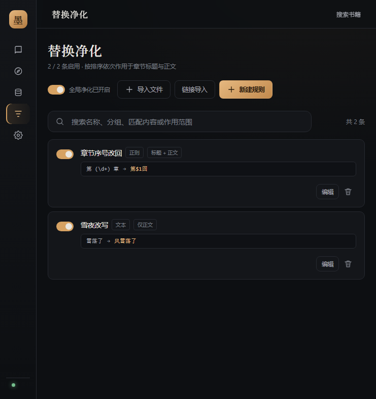


### 设置

- **阅读外观**：主题、字体、翻页方式、字号、行高、段距、页宽；保存后写入后端设置，并同步到阅读器 `localStorage` 的默认排版。
- **替换净化**：全局开关与已启用规则数，可直接跳转管理页。
- **缓存与存储**：正文缓存开关/保留天数、封面与正文缓存大小、分别清理或全部清理；清理立即生效。
- **数据与服务**：书架/书源/规则数量、数据库大小、数据目录与服务版本。

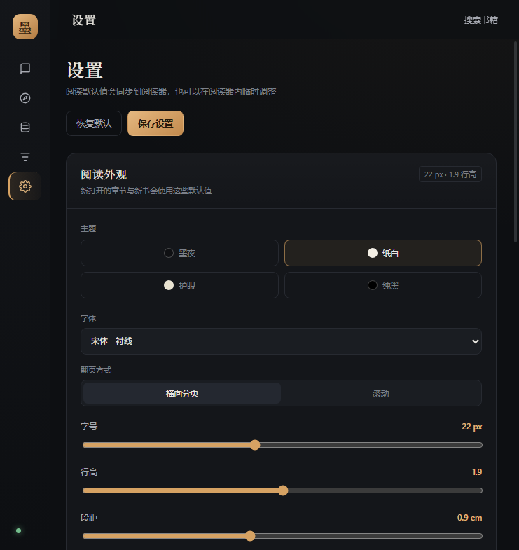
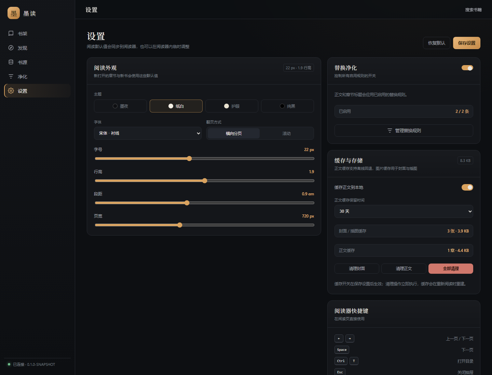
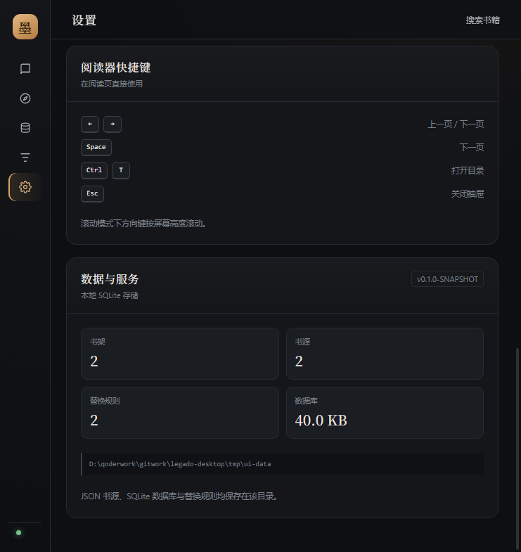

### 封面

- 书架、搜索结果、详情抽屉、换源候选的封面统一通过 `/img` 代理加载，并携带 `source`/`book` 参数。
- 后端按书源 `header` 设置 UA/Referer/Cookie，支持 `coverDecodeJs`，结果落 `data/cache/covers` 磁盘缓存。
- 图片加载失败时隐藏 ``，显示书名首字占位，不再出现浏览器破图图标。
- 封面懒加载；正文图片仍直接引用源站，后续接入同一代理。

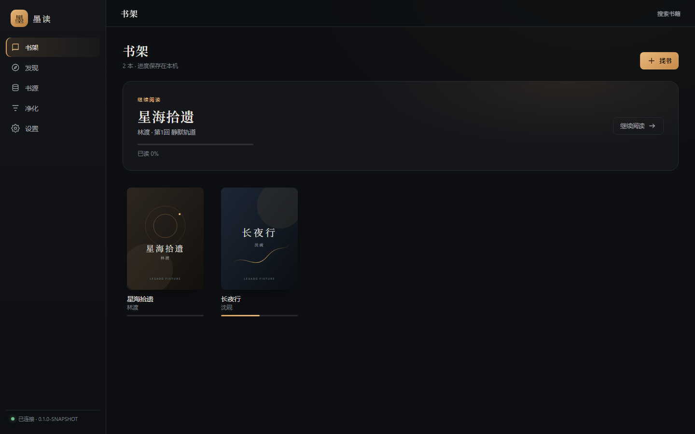
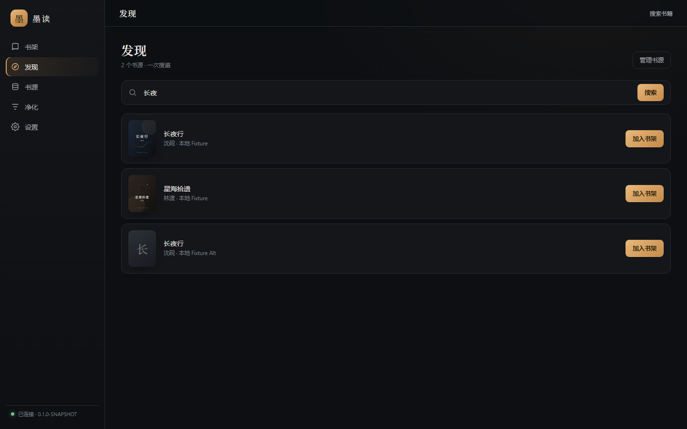

## API 映射

| 页面动作 | API |
| --- | --- |
| 书架加载 | `GET /api/books` |
| 搜索 | `POST /api/search` |
| 加入书架 | `POST /api/books` |
| 书源列表 | `GET /api/sources` |
| 订阅导入 | `POST /api/sources/import` `{url}` |
| 文件导入 | `POST /api/sources/import`（JSON 对象/数组） |
| 删除书源 | `DELETE /api/sources?key=` |
| 目录 | `GET /api/books/chapters?url=` |
| 正文 | `GET /api/books/content?url=&index=`（含 `blocks`） |
| 进度 | `PUT /api/books/progress` |
| 书签 | `GET/POST/DELETE /api/bookmarks` |
| 正文图片 | `GET /img?kind=content&...` |
| 替换规则列表 | `GET /api/replace-rules` |
| 保存/删除/启停规则 | `POST/DELETE /api/replace-rules`、`POST /api/replace-rules/enabled` |
| 规则导入/测试 | `POST /api/replace-rules/import`、`POST /api/replace-rules/test` |
| 设置读写 | `GET/PUT /api/settings` |
| 数据统计 | `GET /api/stats` |
| 缓存统计/清理 | `GET/DELETE /api/cache` |
| 封面 / 正文图片 | `GET /img?kind=cover\|content&...` |

## 开发鉴权

- 本机开发：服务端加 `--dev-no-auth`，`/api/*` 跳过 Cookie。
- 正式模式：先访问 `/bootstrap?token=...` 换取 `sid` HttpOnly Cookie。
- Vite dev 代理到 `127.0.0.1:1122`，见 `frontend/vite.config.ts`。

## 已验证（fixture）

- 书架加载 2 本；点击进入阅读器，目录 2 章，正文正确。
- 切换第 2 章后正文更新，`durChapterIndex` 落库为 1。
- 搜索「长夜」返回 2 条；加入第二本后书架变 2 本，按钮变“已在书架”。
- 详情抽屉打开，2 章可跳转；点击第 2 章进入阅读器 `index=1`。
- 换源候选来自 Alt 源，切换后书架 URL 变为 `book1-alt.html`，进度保留；再切回原源正常。
- 书源启停开关落库 `enabled=false`，再启用恢复。
- 替换规则：新建正则规则后标题变为“第1回 雪夜”，正文规则将“雪落了”替换为“风雪落了”；单条停用和全局暂停均实时回退原文。
- 规则链接导入、编辑器内测试、删除均正常。
- 设置页保存 `theme=paper`、`fontSize=22` 后，清空 `localStorage` 再进阅读器，排版按后端默认值生效。
- 书架、搜索、详情封面通过 `/img` 正常加载；无效封面回退到书名首字；缓存文件写入 `data/cache/covers`。
- 正文图片在分页与滚动模式正常显示，图片经 `/img?kind=content` 加载。
- 书签新增、列表、跳转与删除；章内搜索返回多页命中并高亮关键词。
- 缓存：正文落盘、关闭缓存后不再写入、清理封面/正文后统计归零；停掉 fixture 并重启应用后仍能读到已缓存章节。
- 控制台无报错。

复现：

```bash
# fixture 站点
./gradlew :server:run --args="--port 8098 --data-dir tmp/fixture-data --static-dir examples/fixture-site"
# 应用服务（带前端静态资源）
cd frontend && npm run build && cd ..
./gradlew :server:run --args="--port 8099 --dev-no-auth --data-dir tmp/ui-data --static-dir frontend/dist"
# 导入 examples/fixture-source.json（把里面的 8099 改成 8098）
```

## 修复记录

1. **JSON body 中文乱码**：NanoHTTPD `parseBody` 对 `application/json` 默认按 ISO-8859-1 解码。改为 JSON/PUT 直接按 `Content-Length` 读 UTF-8。
2. **阅读器静态回退 500**：路由参数含 `http:` 时 `Path.resolve` 在 Windows 抛 `InvalidPathException`。路由改用 query；静态文件解析也加了保护。
3. **未开始阅读显示 50%**：`durChapterIndex` 默认改为 `-1`，新书进度为 0；读到第 1 章后才是 `(index+1)/total`。
4. **正文被压成一段**：`SourceEngine` 原先用 `Element.text()` 丢失 `<p>/<br>`；改为块级标签转换行，并用 XML parser 保留文本节点换行。byqg.cc 正文现在保留 157 段，去空白后仍与 Android 100% 一致。
5. **分页只按段落切**：超长单段会整段溢出；浏览器端加入段落内二分切分 + 标点回溯。
6. **分页页宽与视口不一致**：页宽会随窗口收敛，track 位移使用实际页宽；裁剪窗口只显示一页。
7. **封面防盗链 / 无 Referer**：前端原先直接加载 `coverUrl` 且设置 `referrerpolicy=no-referrer`；改为 `/img` 代理，由书源 header 提供 UA/Referer/Cookie，并缓存解码后的图片。
8. **Gson 重载书源丢失 header/variable**：`BookSource` 的 header/variable 缓存初始化早于 Gson 反序列化，导致封面请求没有 Referer。改为首次访问时从字段解析，并补 `BookSourceSerializationTest`。

## 当前限制

- 没有备份恢复、WebDAV、TTS、翻页动画；章内搜索只覆盖当前章节，跨章搜索需按章抓取。
- 替换规则不支持 `@js:` 动态替换；规则编辑暂无拖拽排序，可改“排序”数值。
- 设置项目前覆盖阅读默认值、净化与缓存；快捷键、网络代理等仍在规划中。
- 正文图片分页时按固定比例高度排版，竖长图不会按真实宽高占满页面。
